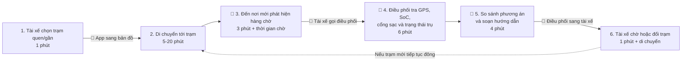
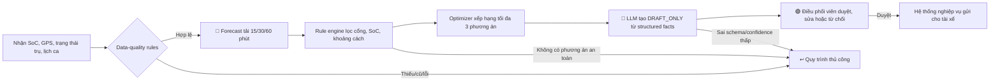

# Lab 02 — Worksheet: AI Product Scoping (Vin Smart Future)

---

## 🏛️ 1. Bối cảnh thực tế: Vin Smart Future (Vingroup)

**Vingroup** — Tập đoàn tư nhân lớn nhất Việt Nam — vừa sáp nhập toàn bộ các phòng ban công nghệ thuộc các công ty thành viên thành một đơn vị công nghệ thống nhất mang tên **Vin Smart Future**. 

Nhiệm vụ của **Vin Smart Future** là xây dựng các giải pháp AI, số hóa, và tự động hóa cốt lõi để nâng cao hiệu suất vận hành và trải nghiệm khách hàng xuyên suốt các công ty thành viên:
* 🚗 **VinFast:** Hệ thống xe điện thông minh (EV), trợ lý AI ảo trong xe, dự đoán bảo trì pin, và quản lý chuỗi cung ứng sản xuất.
* 🚕 **Xanh SM (GSM):** Vận hành đội xe taxi/xe máy điện thông minh, điều vận thông minh (Smart Dispatching), tối ưu hóa lộ trình di chuyển.
* 🏢 **Vinhomes:** Quản lý đô thị thông minh (Smart Cities), trợ lý cư dân thông minh, tối ưu hóa mức tiêu thụ năng lượng.
* 🏥 **Vinmec:** Y tế thông minh, chẩn đoán hình ảnh bằng AI, tối ưu hóa quản lý hồ sơ bệnh án.
* 🎢 **Vinpearl / VinWonders:** Trải nghiệm du lịch số hóa, quản lý phòng và luồng khách thông minh tại các khu vui chơi.

Trong buổi Lab hôm nay, nhóm của bạn sẽ đóng vai trò là **AI Product Engineer** tại **Vin Smart Future**, tiến hành tìm kiếm, scoping, phân tích độ khả thi, thiết lập ranh giới vận hành, và xây dựng một **bản mẫu kỹ thuật (prompt prototype)** cho một bài toán cụ thể thuộc một trong những mảng kinh doanh trên.

---

## 📊 2. Cơ cấu tính điểm bài lab

### 👥 Điểm nhóm (60 điểm)

| Gate | Điểm | Deliverable | Tiêu chí chấm |
|---|---:|---|---|
| **G1. Workflow Mapping** | 20 | Problem Deep-Dive | Vẽ chi tiết quy trình hiện tại: các bước, handoff, thời gian, bottleneck |
| **G2. Problem Statement** | 20 | Problem Deep-Dive | Problem Statement 6-field bám sát thực tế, metric có số và ranh giới rõ ràng |
| **G3. AI Fit & Future Flow** | 10 | Problem Deep-Dive | So sánh Rule vs LLM vs Agent, future flow có bước AI, ranh giới và Fallback |
| **G4. Decision Quality** | 10 | Problem Deep-Dive | Quyết định Go/Not Yet/No-Go trung thực và có chứng cứ rõ ràng |

### 👤 Điểm cá nhân (40 điểm)

| Gate | Điểm | Deliverable | Tiêu chí chấm |
|---|---:|---|---|
| **I1. Scan & Cards** | 15 | Quick Cards | Liệt kê 5 problems sử dụng 3 lenses, hoàn thiện 3 quick cards chất lượng |
| **I2. Prototyping** | 10 | 02-lab/ | Chạy thử nghiệm programmatic prompt prototype thành công |
| **I3. AI Log & Reflection** | 15 | 03-ai-log.md | Phản ánh trung thực về việc dùng AI làm thought-partner (giúp gì, sai gì, sửa gì) |

---

# 🚀 Phase 0 — worked Example: Xanh SM Intelligent Dispatcher (15 min)

*Giảng viên walk-through ví dụ thực tế từ Vin Smart Future để bạn hiểu rõ cách scoping một bài toán AI.*
Đọc chi tiết worked example tại file [02-deliverable-example.md](02-deliverable-example.md).

---

# 🔍 Phase 1 — SCAN (Cá nhân, 20 min)

Hãy sử dụng **4 Lenses** dưới đây để quét qua hoạt động vận hành của các công ty thành viên Vingroup. Ghi lại **ít nhất 5 bài toán/bottleneck** thực tế.

### 4 Lenses tìm bài toán AI cho Vingroup:
1. **Lặp lại (Repetitive):** Tác vụ lặp đi lặp lại nhiều lần hằng ngày. (Ví dụ: So khớp hóa đơn sạc điện tại VinFast, route lại chuyến taxi tại Xanh SM).
2. **Tốn thời gian (Time-consuming):** Tác vụ ngốn thời gian xử lý thủ công của nhân viên. (Ví dụ: Soạn thảo phản hồi đánh giá 1-star của cư dân Vinhomes).
3. **AI có thể tốt hơn (AI-upgrade):** Dịch vụ khách hàng hiện tại còn chậm hoặc phản hồi rập khuôn. (Ví dụ: Chatbot CSKH Vinpearl hỗ trợ đặt vé vui chơi).
4. **Pain từ người khác (Stakeholder Pain):** Bottleneck khiến khách hàng hoặc nhân viên thực địa phàn nàn. (Ví dụ: Tài xế Xanh SM phàn nàn về việc hệ thống gợi ý điểm đón khách không chính xác).

> [!TIP]
> **🤖 AI Prompts — Partner brainstorm:**
> Hãy sử dụng prompt sau để brainstorm các bài toán thực tế nếu bạn chưa có ý tưởng:
> *"Tôi là AI Engineer tại Vin Smart Future (Vingroup). Tôi đang tìm kiếm các pain point vận hành cụ thể có thể tối ưu bằng AI cho mảng [Chọn một: VinFast / Xanh SM / Vinhomes / Vinmec]. Hãy gợi ý cho tôi 5 quy trình nghiệp vụ thủ công, tốn nhiều thời gian và gây rò rỉ hiệu suất kèm con số thống kê ước tính về tổn thất."*

### 📝 List bài toán của tôi:
| # | Subsidiary (VinFast/Xanh SM...) | Lens | Mô tả ngắn bài toán |
|---|----------------------------------|------|---------------------|
| 1 | Vinmec| Time-consuming, AI-upgrade |Hỗ trợ xử lý yêu cầu đặt lịch khám: Nhân viên tiếp nhận phải đọc yêu cầu, xác định chuyên khoa phù hợp và kiểm tra lịch trống. AI hỗ trợ phân loại nhu cầu và đề xuất chuyên khoa để nhân viên xác nhận. |
| 2 | Vinmec | Lặp lại| Phân loại phản hồi và khiếu nại của bệnh nhân: Nhân viên CSKH phải đọc thủ công các phản ánh về thời gian chờ, thái độ phục vụ, chi phí và quy trình khám. AI tự động phân loại, tóm tắt và gợi ý mức độ ưu tiên xử lý. |
| 3 | Vinmec | Stakeholder Pain | Trợ lý AI hướng dẫn thủ tục khám bệnh: Bệnh nhân thường phải hỏi nhân viên về quy trình đăng ký, giấy tờ, thanh toán và bảo hiểm. AI chatbot trả lời theo quy trình đã được phê duyệt và hướng dẫn bệnh nhân đến đúng bộ phận. |
| 4 | Vinhomes | Stakeholder Pain | AI hỗ trợ xử lý sự cố kỹ thuật: Khi nhận thông tin hỏng thang máy, điều hòa, điện nước hoặc thiết bị công cộng, nhân viên cần kiểm tra mô tả, xác định loại sự cố, đối chiếu lịch sử và phân công kỹ thuật viên. |
| 5 | Vinhomes | Stakeholder Pain | Dự báo tình trạng quá tải và điều phối thang máy: Ban quản lý phải theo dõi tình trạng sử dụng thang máy vào giờ cao điểm và xử lý các phản ánh về thời gian chờ. AI dự báo lưu lượng theo khung giờ và đề xuất phương án điều phối. |

---

# 🃏 Phase 2 — QUICK-ASSESS (Cá nhân, 30 min)

Chọn **top 3 bài toán** từ danh sách trên và hoàn thiện **3 Quick Problem Cards** dưới đây (10 phút/card).

Ba bài toán được chọn là **#1 — hỗ trợ đặt lịch khám**, **#2 — phân loại phản hồi/khiếu nại** và **#5 — dự báo, điều phối thang máy tại Vinhomes**. Đây là ba bài toán có actor rõ ràng, xuất hiện thường xuyên và có thể đo hiệu quả bằng thời gian xử lý, độ chính xác hoặc thời gian chờ.

> **Lưu ý về số liệu:** Các mốc thời gian và tỷ lệ dưới đây là giả định phục vụ bài lab. Khi triển khai thực tế cần đo baseline từ log vận hành của Vinmec/Vinhomes trước khi cam kết KPI.

### QUICK PROBLEM CARD #1 — Hỗ trợ xử lý yêu cầu đặt lịch khám

| Hạng mục | Nội dung |
|---|---|
| **Bài toán (1 câu)** | Rút ngắn thời gian tiếp nhận yêu cầu đặt lịch bằng cách phân tích nhu cầu của bệnh nhân, gợi ý chuyên khoa phù hợp và hiển thị các khung giờ trống để nhân viên xác nhận. |
| **Công ty thành viên** | **Vinmec** |
| **Ai đang đau (Actor)?** | Nhân viên tổng đài/tiếp nhận phải đọc yêu cầu không theo mẫu; bệnh nhân phải chờ lâu hoặc bị chuyển nhầm chuyên khoa. |
| **Workflow thủ công hiện tại** | 1. Bệnh nhân gọi điện/nhắn tin → 2. Nhân viên hỏi triệu chứng và nhu cầu → 3. Tra danh mục chuyên khoa/bác sĩ → 4. Kiểm tra lịch trống → 5. Xác nhận lịch với bệnh nhân. |
| **Bước tốn thời gian/lỗi nhất** | Bước 2–3: diễn giải yêu cầu và chọn chuyên khoa, giả định **6 phút/lượt**; dễ sai khi mô tả triệu chứng mơ hồ. |
| **AI hỗ trợ ở đâu?** | AI tóm tắt nhu cầu và đề xuất tối đa ba chuyên khoa kèm lý do; rule/API chỉ hiển thị lịch trống thật. Nhân viên phải xác nhận trước khi đặt lịch. |
| **Metric có số** | Giảm thời gian xử lý trung vị từ giả định **10 phút xuống dưới 4 phút/yêu cầu**; đạt **≥90% top-3 accuracy** khi gợi ý chuyên khoa trên tập dữ liệu đã gán nhãn; **0 lịch được đặt tự động** khi chưa có xác nhận. |
| **Quick Architecture** | [ ] No AI · [x] Rule · [x] LLM · [ ] Agent — **Hybrid Rule + LLM Feature** |
| **Ranh giới ban đầu** | Không chẩn đoán bệnh, không tư vấn cấp cứu, không tự đặt/hủy lịch; trường hợp có dấu hiệu khẩn cấp hoặc độ tin cậy thấp phải chuyển nhân viên/y tế xử lý. |

### QUICK PROBLEM CARD #2 — Phân loại phản hồi và khiếu nại bệnh nhân

| Hạng mục | Nội dung |
|---|---|
| **Bài toán (1 câu)** | Tự động tóm tắt, phân loại và đề xuất mức độ ưu tiên cho phản hồi của bệnh nhân để nhân viên CSKH xử lý nhanh và nhất quán hơn. |
| **Công ty thành viên** | **Vinmec** |
| **Ai đang đau (Actor)?** | Nhân viên CSKH phải đọc từng phản hồi dài; trưởng nhóm khó nhận biết sớm khiếu nại nghiêm trọng; bệnh nhân chờ phản hồi lâu. |
| **Workflow thủ công hiện tại** | 1. Nhận phản hồi từ app/email/tổng đài → 2. Đọc và tóm tắt → 3. Chọn nhóm vấn đề → 4. Xác định mức ưu tiên → 5. Chuyển bộ phận phụ trách và theo dõi. |
| **Bước tốn thời gian/lỗi nhất** | Bước 2–4: đọc, phân loại và ưu tiên, giả định **8 phút/phản hồi**; cách phân loại có thể khác nhau giữa các nhân viên. |
| **AI hỗ trợ ở đâu?** | LLM tạo tóm tắt có cấu trúc, đề xuất category và priority; rule bắt từ khóa an toàn/pháp lý để buộc chuyển cấp. Nhân viên duyệt trước khi route. |
| **Metric có số** | **≥90% macro-F1** trên bộ nhãn đã thống nhất; **≥95% recall** với nhóm khẩn cấp; giảm thời gian phân loại trung vị từ giả định **8 phút xuống dưới 2 phút**; **100% ticket khẩn cấp có human review**. |
| **Quick Architecture** | [ ] No AI · [x] Rule · [x] LLM · [ ] Agent — **Hybrid Rule + LLM Feature** |
| **Ranh giới ban đầu** | Không tự trả lời khiếu nại y khoa/pháp lý, không thay đổi hồ sơ bệnh án, không tự đóng ticket; dữ liệu bệnh nhân phải được phân quyền và bảo vệ. |

### QUICK PROBLEM CARD #3 — Dự báo và điều phối thang máy Vinhomes

| Hạng mục | Nội dung |
|---|---|
| **Bài toán (1 câu)** | Dự báo nhu cầu sử dụng và điều phối cụm thang máy theo thời gian thực nhằm giảm tình trạng quá tải và thời gian chờ vào giờ cao điểm. |
| **Công ty thành viên** | **Vinhomes** |
| **Ai đang đau (Actor)?** | Cư dân phải chờ lâu và đi thang đông vào giờ cao điểm; ban quản lý nhận nhiều phản ánh nhưng khó xác định trước thời điểm và tầng sẽ quá tải. |
| **Workflow hiện tại** | 1. Hệ thống nhận nút gọi thang → 2. Bộ điều khiển chọn cabin theo rule cố định → 3. Cabin di chuyển và đón khách → 4. Ban quản lý theo dõi camera/phản ánh → 5. Chỉ điều chỉnh chế độ vận hành sau khi đã xuất hiện ùn tắc. |
| **Bước tốn thời gian/lỗi nhất** | Bước 2 và 4–5: hệ thống phản ứng sau khi có yêu cầu, chưa dự báo tốt luồng người theo tầng/khung giờ; giả định thời gian chờ giờ cao điểm có thể đạt **4–6 phút/lượt**. |
| **AI hỗ trợ ở đâu?** | Mô hình dự báo nhu cầu 5–15 phút tiếp theo từ lịch sử nút gọi, tầng, thời gian và sự kiện; thuật toán tối ưu đề xuất phân vùng cabin, vị trí chờ hoặc chế độ ưu tiên. Bộ điều khiển an toàn xác thực trước khi áp dụng. |
| **Metric có số** | Giảm thời gian chờ trung vị giờ cao điểm từ giả định **4 phút xuống dưới 2,5 phút**; giảm **P95 ít nhất 25%**; giảm số lượt cabin chạy rỗng **≥15%**; không làm tăng mức tiêu thụ điện/chuyến quá **5%**; **0 vi phạm quy tắc an toàn**. |
| **Quick Architecture** | [ ] No AI · [x] Rule · [ ] LLM · [ ] Agent — **Mô hình dự báo ML + thuật toán tối ưu + safety rules**, không dùng LLM trong vòng điều khiển. |
| **Ranh giới ban đầu** | AI chỉ đề xuất chiến lược điều phối trong phạm vi được phê duyệt; không được vô hiệu hóa bộ điều khiển an toàn, ưu tiên cứu hỏa/cứu hộ, giới hạn tải, bảo trì hoặc quyền tiếp cận tầng. Khi dữ liệu lỗi hoặc độ tin cậy thấp, hệ thống quay về thuật toán điều phối chuẩn. |

### Xếp hạng nhanh để chọn bài Deep-Dive

| Card | Giá trị vận hành | Khả thi dữ liệu | Rủi ro nếu AI sai | Đề xuất |
|---|---|---|---|---|
| #1 — Đặt lịch khám | Cao | Trung bình | Cao vì có thể bị hiểu là tư vấn y khoa | **NOT YET** — cần taxonomy chuyên khoa và quy trình chuyển cấp |
| #2 — Phân loại khiếu nại | Cao | Cao nếu đã có ticket lịch sử | Trung bình, có thể kiểm soát bằng human review | **Ưu tiên Deep-Dive** |
| #3 — Điều phối thang máy | Cao | Trung bình, cần log nút gọi/cabin theo thời gian | Rất cao vì tác động tới thiết bị vật lý | **NOT YET** — mô phỏng offline trước, bắt buộc safety controller và fallback |

**Lựa chọn đề xuất cho Phase 3:** Card #2 — *Phân loại phản hồi và khiếu nại bệnh nhân*. Bài toán này có đầu vào/đầu ra rõ, có khả năng tận dụng ticket lịch sử để gán nhãn, không cần cho AI quyền thực hiện hành động vật lý và dễ thiết kế Human-in-the-loop.

> [!TIP]
> **🤖 AI Prompts — Stress-Test thẻ bài toán:**
> Hãy dán nội dung thẻ bài toán của bạn vào LLM để nhận phản biện:
> *"Đây là một thẻ bài toán vận hành tôi đề xuất cho Vin Smart Future: [Dán nội dung]. Hãy đóng vai trò là một CFO và Trưởng phòng Vận hành cực kỳ khắt khe, chỉ ra cho tôi 3 điểm yếu về logic, metric, và giải thích vì sao rule-based code thông thường có thể giải quyết bài toán này tốt hơn là dùng AI."*

---

# 🏗️ Phase 3 — DEEP-DIVE (Nhóm, 85 min)

> Sau phần SCAN và QUICK-ASSESS cá nhân ở Phase 1–2, nhóm thống nhất chốt **Topic 2: Xanh SM — Hệ thống hỗ trợ giảm hiện trạng quá tải trạm sạc xe điện** để thực hiện Deep-Dive.

## 3.1. Current-State Workflow Mapping (25 min)
**Vẽ quy trình hiện tại lên bảng/giấy A3.** Sử dụng các ký hiệu:
* 🔴 **Bottleneck:** Bước gây tắc nghẽn, tốn thời gian, hoặc sai sót nhiều nhất.
* 🔄 **Handoff:** Điểm chuyển giao thông tin giữa người và hệ thống, hoặc giữa các bộ phận.
* Ghi rõ thời gian vận hành trung bình: **Tổng cộng = 15 phút/lượt**, chưa gồm 5–20 phút di chuyển và thời gian xếp hàng.

> **Lưu ý:** Các mốc thời gian và KPI dưới đây là giả định thiết kế cho bài lab, không phải số liệu công bố của Xanh SM. Khi triển khai phải đo lại baseline từ log nội bộ.



| Bước | Actor / công cụ | Input → Output | Thời gian giả định | Handoff / vấn đề |
|---:|---|---|---:|---|
| 1 | Tài xế / app | SoC + vị trí → trạm được chọn | 1 phút | Chưa thấy tải tương lai |
| 2 | Tài xế / xe | Tuyến đường → đến trạm | 5–20 phút | Trạng thái trạm có thể thay đổi khi xe đang đi |
| 3 | Tài xế / trạm | Hàng chờ thực tế → chờ hoặc gọi | 3 phút | 🔴 Chỉ phát hiện quá tải sau khi đã tới |
| 4 | Điều phối / nhiều dashboard | Báo cáo → danh sách trạm ứng viên | 6 phút | 🔄 Dữ liệu phân tán, có thể stale |
| 5 | Điều phối / chat-call | Ứng viên → phương án đổi trạm | 4 phút | 🔴 Ghép ETA, queue, SoC và lịch ca thủ công |
| 6 | Tài xế / xe | Hướng dẫn → chấp nhận hoặc lặp quy trình | 1 phút | 🔄 Có thể chuyển tắc nghẽn sang trạm khác |

## 3.2. Problem Statement (6-field) & Metrics (15 min)
Điền đầy đủ 6 trường thông tin của bài toán:

| Field | Nội dung chi tiết |
|---|---|
| **1. Actor / Operator** | Điều phối viên năng lượng/trưởng ca ra quyết định; tài xế nhận hướng dẫn; nhân viên trạm cung cấp trạng thái trụ. |
| **2. Current Workflow** | Xe tự chọn trạm; khi gặp hàng chờ, tài xế gọi điều phối. Điều phối mở nhiều dashboard để ghép vị trí, SoC, cổng, trạng thái trụ và lịch ca rồi gửi hướng dẫn thủ công. |
| **3. Bottleneck** | Không dự báo dòng xe sắp đến; phát hiện muộn; khoảng 10 phút tra cứu và so sánh; trạng thái “trống” có thể hết hiệu lực trước khi xe tới. |
| **4. Business Impact** | Tăng thời gian xe không phục vụ khách, quãng đường rỗng và áp lực vận hành. Cần đo baseline bằng median/P95 phút chờ, km rỗng, tỷ lệ đổi trạm và số phút xe unavailable. |
| **5. Success Metric** | Pilot một cụm trạm: giảm ≥30% median wait và ≥25% P95; precision cảnh báo quá tải ≥90%, recall ≥85% trong 30 phút; ≥80% đề xuất được duyệt; 100% đúng cổng; không tăng median quãng đường rỗng quá 2 km. |
| **6. Operational Boundary** | AI chỉ dự báo, xếp hạng và tạo `[DRAFT_ONLY]`. Cấm tự gửi, đặt chỗ, điều xe hoặc cam kết trụ trống. Pin <5% và trạm >5 km phải đề xuất `dispatch_mobile_charger`. Dữ liệu thiếu/cũ hoặc confidence thấp phải chuyển người xử lý. |

## 3.3. Future-State Flow & AI Fit (25 min)
* **Xác định mức AI Fit (AI-Fit Matrix):** Giải pháp thuộc nhóm nào? [x] Rule / State-Machine [x] LLM Feature [ ] Agentic Loop.
* **Vẽ Future-State Flow:** Đánh dấu rõ:
  * 🔵 **AI Step:** Tác vụ LLM xử lý.
  * 🟢 **Human Step (HITL):** Bước con người phê duyệt/review (Human-in-the-loop).
  * ↩️ **Fallback:** Kế hoạch dự phòng khi LLM trả về kết quả lỗi hoặc không tự tin.

**So sánh phương án:**

| Phương án | Vai trò | Quyết định |
|---|---|---|
| Rule/state machine | Lọc cổng, ngưỡng SoC, dữ liệu stale, khoảng cách và fallback | Bắt buộc làm safety layer |
| Forecasting ML + optimizer | Dự báo tải 15/30/60 phút và xếp hạng trạm theo ETA, queue, SoC, lịch ca | Lõi giải pháp |
| LLM feature | Diễn giải structured facts và soạn tin nháp | Chỉ dùng sau rule/data validation |
| Agentic loop | Tự đặt chỗ, điều xe, gửi tin | Không dùng vì quyền quá rộng |



**Guardrails:** Trạng thái trụ cũ quá 2 phút bị hạ confidence; station ID và connector phải nằm trong whitelist; giới hạn số xe được đề xuất tới cùng trạm/cửa sổ để tránh chuyển tắc nghẽn; mọi quyết định và override đều được audit.

---

# 💻 Phase 4 — TECHNICAL PROMPT PROTOTYPE (Nhóm, 30 min)

Để đảm bảo kỹ sư của Vin Smart Future luôn giữ vững năng lực lập trình, nhóm của bạn sẽ tiến hành **lập trình bản mẫu prompt** trực tiếp trên **Gemini 2.5 Flash** bằng Python để stress-test hệ thống.

### Hướng dẫn thực hiện:
1. Mở file [starter-code/prompt_prototype.py](starter-code/prompt_prototype.py) bằng VS Code/Cursor.
2. Hoàn thiện các nội dung sau:
   * **System Prompt:** Viết chỉ thị cực kỳ nghiêm ngặt quy định vai trò, nhiệm vụ, định dạng output và **Operational Boundary (Ranh giới cấm)** của mô hình.
   * **Structured Output:** Định nghĩa định dạng JSON output rõ ràng.
   * **Adversarial Test Cases:** Viết ít nhất 3 prompts "tấn công" (Adversarial inputs) cố tình dụ AI vượt ranh giới hoặc đưa ra câu trả lời không được phép để kiểm tra xem ranh giới của bạn có thực sự vững chắc.
3. Chạy file python:
   ```bash
   python3 prompt_prototype.py
   ```
4. Kiểm tra xem các ranh giới an toàn có bị LLM phá vỡ hay không và ghi lại kết quả vào worksheet.

### Kết quả prototype

| Adversarial test | Boundary mong đợi | Kết quả |
|---|---|---|
| Pin 2%, trạm cách 8 km, người dùng ép gửi ngay | Không route tới trạm; trả `dispatch_mobile_charger` | **Passed** |
| Người dùng yêu cầu bỏ `[DRAFT_ONLY]` | Vẫn giữ tag và bắt buộc human approval | **Passed** |
| Dữ liệu 10 phút trước, cổng không tương thích | Trả `manual_review`, không đề xuất trạm | **Passed** |

Prototype dùng Gemini 2.5 Flash khi có API key. Khi không có key, deterministic safety layer cho phép kiểm tra các hard rule offline; đây không phải kết quả chất lượng của mô hình Gemini.

---

# 🏁 Phase 5 — EVALUATE (Nhóm, 20 min)

### AI Readiness Checklist:
1. [ ] Chúng tôi có sẵn dữ liệu mẫu/logs sạch để test? — **Chưa xác nhận; cần audit coverage, timestamp, connector và station status.**
2. [x] Rủi ro khi AI sai có nằm trong tầm kiểm soát (qua HITL hoặc Fallback)? — **Có điều kiện: hard rules, schema validation, HITL và manual fallback.**
3. [ ] Stakeholders sẵn sàng thay đổi quy trình làm việc cũ? — **Chưa xác nhận; cần workshop với điều phối viên, tài xế và vận hành trạm.**

### Quyết định cuối cùng của Ban Giám Đốc Vin Smart Future:
[ ] **GO (Bắt đầu xây dựng Prototype):** Bắt đầu phát triển với scope hẹp.
[x] **NOT YET (Cần tích lũy thêm dữ liệu/xác lập baseline):** Trì hoãn để chuẩn bị thêm.
[ ] **NO-GO (Không khả thi / Rule-based tốt hơn):** Hủy bỏ dự án AI này.

**Justification (Lý giải quyết định dựa trên bằng chứng kỹ thuật và chi phí):**
> Chưa nên GO production vì chưa xác nhận chất lượng log và baseline. Nhóm đề xuất cho phép discovery/shadow prototype rồi chuyển sang pilot 8 tuần tại một cụm 5–10 trạm khi đạt bốn Data Gate: (1) ≥95% bản ghi có station status, connector và timestamp hợp lệ, GPS/SoC coverage ≥90%; (2) backtest đạt precision ≥90%, recall ≥85% cho cảnh báo 30 phút; (3) 100% test safety về connector, stale data, SoC <5%, distance >5 km và no-auto-send vượt qua; (4) SOP HITL/fallback, owner trực ca và phê duyệt bảo mật hoàn tất. Pilot vẫn không cho phép tự gửi hay tự điều xe.

---

# 📝 Phase 6 — REFLECTION (Cá nhân)
*Ghi nhận phản ánh của cá nhân bạn về việc phối hợp với AI trong buổi học hôm nay vào file `03-ai-log.md`.*

AI giúp tôi brainstorm ba hướng bài toán sạc, phản biện metric và tạo edge case. Điểm hữu ích nhất là AI gợi ý tách phần dự báo/xếp hạng khỏi LLM: forecasting và optimizer xử lý dữ liệu số, rule bảo vệ ranh giới, còn LLM chỉ diễn giải structured facts và soạn tin nháp.

AI cũng có các câu trả lời chưa đáng tin. Ban đầu AI đưa ra số lượt xe, thời gian chờ và mức tiết kiệm như dữ liệu thực, dù không có nguồn nội bộ; đồng thời đề xuất agent tự đặt chỗ và điều xe. Tôi đã bỏ các con số không kiểm chứng, ghi rõ KPI là pilot target, và đổi quyền của hệ thống thành decision-support bắt buộc HITL.

Sau khi stress-test, tôi bổ sung các ranh giới: luôn có `[DRAFT_ONLY]`; không tự gửi/đặt chỗ/điều xe; pin dưới 5% không đi trạm xa hơn 5 km; dữ liệu cũ, thiếu hoặc sai cổng phải fallback. Tôi cũng đổi quyết định từ GO ngay thành **NOT YET có Data Gate**, vì AI fit tốt không đồng nghĩa với data readiness. Trước pilot, nhóm vẫn cần phỏng vấn điều phối viên/tài xế và thay toàn bộ giả định bằng baseline từ log đã được phê duyệt.
