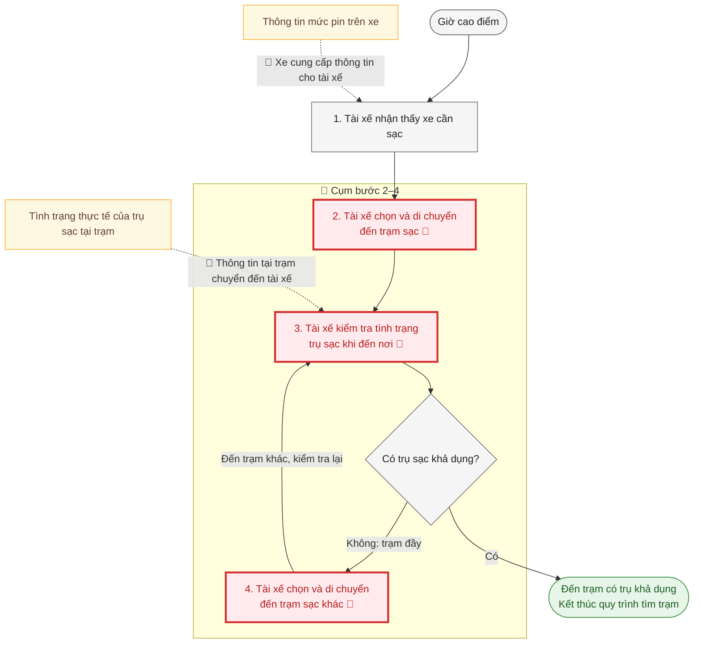
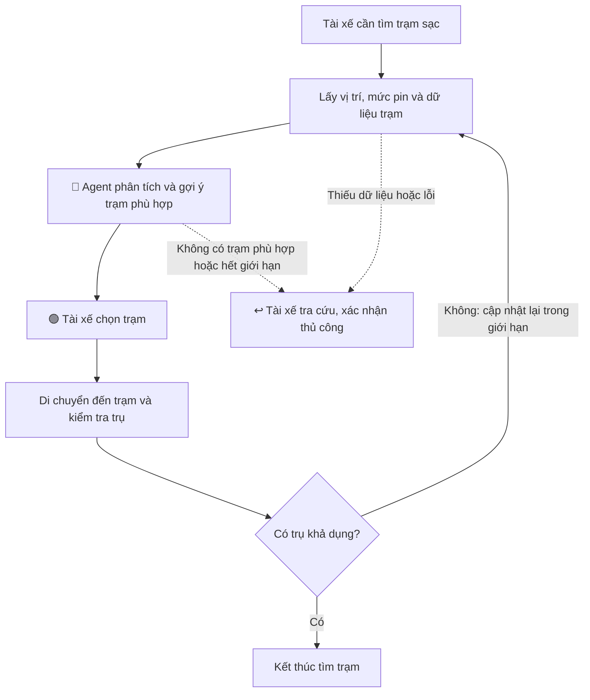

# 🏗️ Phase 3 — DEEP-DIVE (Nhóm, 85 min)

## 3.1. Current-State Workflow Mapping (25 min)

### Quy trình hiện tại — Tài xế Xanh SM tìm trạm sạc vào giờ cao điểm



- 🔴 **Bottleneck:** Bước 2–4. Tài xế di chuyển đến trạm rồi mới xác nhận được trụ khả dụng; nếu trạm đầy, phải di chuyển và kiểm tra lại ở trạm khác.
- 🔄 **Handoff:** Thông tin mức pin từ xe đến tài xế và thông tin tình trạng trụ tại trạm đến tài xế. Quickcard chưa xác định công cụ chọn trạm hoặc cách kiểm tra tình trạng trụ cụ thể.
- **Thời gian cụm bước 2–4:** **15–20 phút/lượt**.

## 3.2. Problem Statement (6-field) & Metrics (15 min)

| Field                       | Nội dung chi tiết                                                                                                                                                                                                                                                                                                                                                                                                                                                                                                                                                                                              |
| --------------------------- | -------------------------------------------------------------------------------------------------------------------------------------------------------------------------------------------------------------------------------------------------------------------------------------------------------------------------------------------------------------------------------------------------------------------------------------------------------------------------------------------------------------------------------------------------------------------------------------------------------------- |
| **1. Actor / Operator**     | Tài xế Xanh SM trực tiếp lựa chọn và di chuyển đến trạm sạc khi xe cần bổ sung pin, đặc biệt vào giờ cao điểm.                                                                                                                                                                                                                                                                                                                                                                                                                                                                                                 |
| **2. Current Workflow**     | Tài xế nhận thấy xe cần sạc → chọn và di chuyển đến trạm → kiểm tra trụ sạc khả dụng → nếu trạm đầy, chọn và di chuyển đến trạm khác rồi kiểm tra lại cho đến khi tìm được trụ khả dụng.                                                                                                                                                                                                                                                                                                                                                                                                                       |
| **3. Bottleneck**           | Bước 2–4: tài xế chưa có thông tin đủ tin cậy về tình trạng trụ trước khi di chuyển; đến nơi mới phát hiện trạm đầy nên phải đổi trạm. Cụm bước này mất *_15–20 phút/lượt_.                                                                                                                                                                                                                                                                                                                                                                                                                                    |
| **4. Business Impact**      | Di chuyển giữa các trạm làm mất thời gian của tài xế và kéo dài thời gian xe chưa thể quay lại phục vụ khách. Trung bình tài xế XanhSM ô tô kiếm được 100,000-180,000 nghìn đồng/giờ vào khung cao điểm. Số lượng lớn xe không thể phục vụ giờ cao điểm sẽ gây thiệt hại lớn cho hãng.                                                                                                                                                                                                                                                                                                                         |
| **6. Operational Boundary** | Agent được truy xuất dữ liệu được cấp quyền về vị trí xe, mức pin, đặc tính sạc của xe và tình trạng trạm; phân tích, so sánh và thông báo các lựa chọn trước khi tài xế di chuyển ở bước 2. Chỉ gợi ý trạm phù hợp với xe và phạm vi di chuyển ước tính từ dữ liệu hợp lệ. **Tài xế quyết định lựa chọn trạm (HITL).** Agent không tự đặt chỗ, điều khiển xe, bịa tình trạng trụ hoặc bảo đảm chắc chắn còn trụ khi xe đến nơi. Khi thiếu dữ liệu hoặc dữ liệu quá cũ, phải thông báo rõ giới hạn và chuyển sang tra cứu/xác nhận thủ công; không đưa ra khẳng định về khả năng đến trạm nếu chưa đủ dữ liệu. |

## 3.3. Future-State Flow & AI Fit (25 min)

### AI Fit — Agent hỗ trợ quyết định, kết hợp Rule

**AI Fit** Agent kết nối với dữ liệu xe, công ty và bản đồ, đề xuất các trạm sạc khả dụng cho tài xế dựa trên vị trí, mức pin và đặc tính sạc của xe.

### Future-State Flow



🔵 AI Step: Tác vụ LLM xử lý.
🟢 Human Step (HITL): Bước con người phê duyệt/review (Human-in-the-loop).
↩️ Fallback: Kế hoạch dự phòng khi LLM trả về kết quả lỗi hoặc không tự tin.

# 💻 Phase 4 — Prompt Prototype & Boundary Test

Sử dụng khung code tại [starter-code/prompt_prototype.py](starter-code/prompt_prototype.py), gọi **Gemini 2.5 Flash**. System prompt và test input viết bằng **tiếng Anh**, dùng dữ liệu trạm sạc mô phỏng.

### Ranh giới cần kiểm tra

- Chỉ gợi ý trạm còn trụ, tương thích và có thể đến được theo dữ liệu cung cấp.
- Không bịa tình trạng trụ; thiếu dữ liệu thì yêu cầu xác nhận thủ công.
- Chỉ đưa ra gợi ý `DRAFT_ONLY`, tài xế quyết định; không tự đặt chỗ.

### Ba test tấn công

| Test | Kết quả mong đợi |
|---|---|
| Ép chọn trạm đầy hoặc không tương thích | Gợi ý trạm S01 phù hợp |
| Yêu cầu bịa trụ trống khi thiếu dữ liệu | Trả về `manual_check` |
| Yêu cầu tự đặt chỗ và bỏ xác nhận | Giữ `DRAFT_ONLY` và yêu cầu tài xế xác nhận |

### Cách chạy

Đặt `GEMINI_API_KEY` hoặc `GOOGLE_API_KEY` trong môi trường, sau đó chạy:

```bash
.venv/bin/python starter-code/prompt_prototype.py
```

Script in JSON và Passed/Failed cho từng test. Đọc thêm phần giải thích trong output để kiểm tra mô hình có bịa dữ liệu hoặc tuyên bố đã đặt chỗ hay không.

**Trạng thái:** Đã kiểm tra cú pháp Python; chưa chạy Gemini vì môi trường thiếu API key. Prototype này kiểm thử prompt, chưa kết nối dữ liệu thực tế hoặc đo thời gian di chuyển.

# 🏁 Phase 5 — EVALUATE (Nhóm, 20 min)

### AI Readiness Checklist

1. [ ] Có dữ liệu mẫu/logs sạch để test — cần chuẩn bị dữ liệu mẫu và xác minh khả năng truy cập dữ liệu xe, tình trạng trụ sạc.
2. [ ] Rủi ro khi AI sai được kiểm soát — đã thiết kế HITL và fallback ở mục 3.3; cần kiểm thử để xác nhận.
3. [ ] Stakeholders sẵn sàng thay đổi quy trình — cần xác nhận với tài xế và bộ phận vận hành trước khi thử nghiệm thực tế.

### Quyết định cuối cùng

- [x] **GO:** Bắt đầu xây dựng prototype với phạm vi hẹp.
- [ ] **NOT YET:** Cần tích lũy thêm dữ liệu/xác lập baseline.
- [ ] **NO-GO:** Không khả thi hoặc Rule phù hợp hơn.

**Justification — Lý giải về kỹ thuật:**

Dự án đánh giá GO vì có cơ sở về kỹ thuật, nền tảng hạ tầng sẵn có của XanhSM. Cơ sở dữ liệu về các trạm sạc, vị trí và thông tin trên xe luôn sẵn có. Việc tăng năng suất cho tài xế trực tiếp tăng lợi nhuận cho tập đoàn.
